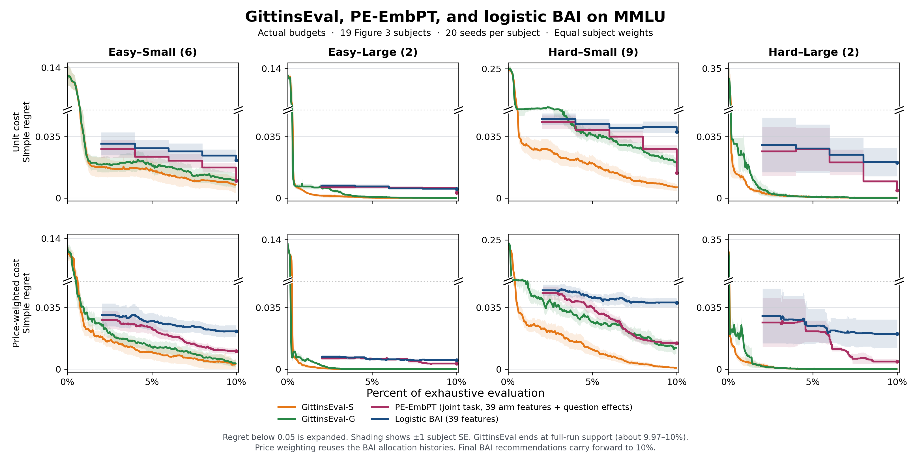

# MMLU PE-EmbPT experiments

At 10% of MMLU evaluation cells, balanced-question PE-EmbPT reduced mean simple regret from **0.02171928 to 0.00905031** and improved on the 39-feature logistic baseline in all 57 subjects. In the separate 19-subject Figure 3 comparison, GittinsEval-S had lower cohort mean regret than both PE-EmbPT variants at all 36 comparable checkpoints.

**Implemented version:** the completed PE-EmbPT runs use concatenation of prompt embeddings and model indicators, with prompt coefficients shared across LLMs and one fitted effect per question. All PE-EmbPT results below belong to this first version. The proposed version with model-specific prompt coefficients has not been run.

[Main figure (PNG)](../PE_EmbPT_data_2026-11-07/figure/Figure3_PE_EmbPT.png) · [Main figure (PDF)](../PE_EmbPT_data_2026-11-07/figure/Figure3_PE_EmbPT.pdf) · [Sampling comparison (PNG)](../PE_EmbPT_data_2026-11-07/figure/Figure3_PE_EmbPT_sampling.png) · [Sampling comparison (PDF)](../PE_EmbPT_data_2026-11-07/figure/Figure3_PE_EmbPT_sampling.pdf)



## What changed

The submitted Figure 3 described its baseline as PE-OneHot. This experiment adds PromptEval-style question effects to an arm-only logistic baseline that already uses pretrained prompt embeddings. All three BAI variants share the same 39 arm features. The first comparison changes the fitted model and recommendation score while retaining random-question sampling. The second holds the fitted model and recommendation score fixed and compares random with balanced questions.

Each MMLU subject has 1,500 arms from crossing 15 LLMs with 100 prompt templates. The arm design contains 25 PCA coordinates from pretrained DPR prompt embeddings and 14 model indicators, with model 0 as the reference. The prompt coordinates are shared across models for the same template. The Rasch variants add one question indicator shared across all 1,500 arms for each of the subject's $N$ questions.

| Method | Fitted design | Arm score | Question sampling |
| --- | --- | --- | --- |
| Logistic BAI (39) | 39 arm features and a constant. No question effects. | Fitted arm score | Uniform among the chosen arm's unseen questions |
| PE-EmbPT, random questions | 39 arm features and $N$ question effects. No separate intercept. | Full-row mean of observed outcomes and fitted probabilities on unseen questions | Same random-question rule as logistic BAI |
| PE-EmbPT, balanced questions | Same $39 + N$ design as random PE-EmbPT | Same full-row mean as random PE-EmbPT | Uniform among the chosen arm's least-covered unseen questions, counting observations across all arms, including eliminated arms |

All fits use observed binary outcomes and native L2 LIBLINEAR logistic regression with $C=100$. The Rasch logit is the sum of the fitted arm score and the fitted question coefficient. The full-row estimate retains each observed answer and fills only unseen entries with fitted probabilities.

### First version: concatenation with shared prompt coefficients

We fit each MMLU subject independently. Let $m$ identify one of the 15 LLMs, $p$ one of its 100 prompt templates, and $q$ one of the subject's $N$ questions. The response matrix has 1,500 model-prompt rows and $N$ question columns. Each row receives the feature vector

$$
x_{m,p}=[e(p);d(m)]\in\mathbb{R}^{39},
$$

where $e(p)\in\mathbb{R}^{25}$ is the cached pretrained prompt embedding after PCA and $d(m)\in\mathbb{R}^{14}$ is the reference-coded model indicator. Model 0 (`meta_llama_llama_3_8b`) has an all-zero indicator; each other model activates its corresponding indicator. A given prompt has the same embedding across all 15 models within a subject. The implementation constructs these rows with `np.hstack([x, llm_oh])`. [Feature construction](../PE_EmbPT_data_2026-11-07/code/source_snapshot/prompteval/bai_evaluation.py#L269-L326)

For an observed response, the fitted logit is

$$
\ell_{m,p,q}=\gamma^\top e(p)+\alpha_m+\eta_q,\qquad \alpha_0=0.
$$

The 25 coefficients in $\gamma$ are shared across models; the 14 free $\alpha_m$ coefficients provide model offsets. These are **39 learned arm coefficients in total per subject**, shared by its 1,500 rows. Question identity features add $N$ coefficients $\eta_q$, each shared across all model-prompt rows. Their positive sign represents question easiness; a difficulty parameter would have the opposite sign. There is no separate intercept, so the PE fit contains **$39+N$ coefficients**.

The same prompt contrast $\gamma^\top(e(p_A)-e(p_B))$ therefore applies to every LLM on the fitted logit scale. This construction transfers evidence about prompt effects across models. It does not learn a model embedding or a model-similarity matrix.

### Fitting and recommendation

At each phase, we call `ExtendedRaschModel.fit(seen, Y, X39, Z=None)`. The native implementation makes `Z` the question identity matrix. We construct the observed-cell design as a sparse matrix containing the 39 arm features and the selected question indicator, then use the native L2 LIBLINEAR fit with $C=100$, `random_state=0`, and `fit_intercept=False`. All responses observed so far participate in fitting, including those from previously eliminated arms. The cached encoder features remain fixed; only the regression coefficients are learned. [Replay adapter and sparse design](../PE_EmbPT_data_2026-11-07/code/source_snapshot/outputs/mmlu_rasch39/run_experiment.py#L32-L105) · [Native estimator](../PE_EmbPT_data_2026-11-07/code/source_snapshot/prompteval/methods.py#L47-L144)

For each arm, we retain actual observed outcomes and predict only unanswered cells. With $O_{m,p}$ denoting its observed questions, the score used for recommendation and elimination is

$$
\widehat S_{m,p}=\frac{1}{N}\left(\sum_{q\in O_{m,p}}Y_{m,p,q}+\sum_{q\notin O_{m,p}}\widehat p_{m,p,q}\right),
$$

where $\widehat p$ is the sigmoid of the fitted logit clipped to $[-30,30]$. This is implemented by `model.get_Y_hat().mean(axis=1)`. It differs from the historical logistic comparator, which ranks arms by their fitted arm logits. Because the PE score retains each arm's own observed outcomes, shared prompt coefficients do not force the final recommendations to have identical prompt rankings across LLMs.

### Allocation and scope

The replay uses five successive-halving phases with cumulative observation budgets of 2%, 4%, 6%, 8%, and 10% of the response matrix. Each evaluation chooses among the least-sampled active arms. The active set sizes before elimination are 1,500, 750, 375, 187, and 93. Each phase reports the highest-scoring active arm. The upstream phase formula would give 11 phases on a 1,500-arm pool. Original PromptEval ranked prompts separately within each model and used the observed empirical mean among surviving prompts for its final recommendation. The results here describe the joint model-prompt adaptation. [Full protocol](../PE_EmbPT_data_2026-11-07/protocol.json)

Both completed PE variants use this same concatenation design and estimator. `rasch39_random` samples an unanswered question uniformly for the chosen arm. `rasch39_balanced` samples among that arm's least-covered unanswered questions, using question counts across all arms, including eliminated arms. Arm and question ties are broken randomly by the seeded sampler. Thus balanced sampling operates inside the BAI elimination schedule.

For a future interaction variant, the proposed arm features would instead be $[\operatorname{onehot}_{15}(m)\otimes e(p);d(m)]$. Each LLM would have its own block of 25 prompt coefficients, giving $15\times25+14=389$ arm coefficients and $389+N$ coefficients after adding question effects. The blocks belong to LLMs: all 100 prompts for one LLM use its same block with their respective embedding values. This version is not implemented in the reported runs, and no interaction results are included. We describe the completed method as **PE-EmbPT adapted to joint model-prompt selection with shared prompt coefficients and question effects**.

### Embedding provenance

The replay uses saved upstream PromptEval feature arrays. The upstream code identifies the encoder as `sentence-transformers/facebook-dpr-question_encoder-multiset-base` and leaves the weight revision unpinned. It encodes unfilled prompt templates, with placeholders for the topic, question, and choices, and applies PCA within each subject. The cached arrays preserve the exact inputs to the experiment. The original encoder snapshot and feature-generation environment are unavailable. PE-EmbFT is outside the scope of this comparison. [Feature provenance](../PE_EmbPT_data_2026-11-07/provenance/feature_provenance.json)

## Results across all 57 subjects

Simple regret is the best arm's full-matrix mean minus the recommended arm's full-matrix mean. Each method uses 20 sampling seeds per subject. We average seeds within subjects and then weight subjects equally.

| Unit budget | Logistic BAI (39) | PE-EmbPT, random | PE-EmbPT, balanced |
| ---: | ---: | ---: | ---: |
| 2% | 0.02624004 | 0.02445305 | 0.02516509 |
| 4% | 0.02458780 | 0.02290746 | 0.02289494 |
| 6% | 0.02393083 | 0.02039984 | 0.02056374 |
| 8% | 0.02322175 | 0.01586805 | 0.01649863 |
| 10% | 0.02171928 | 0.00951678 | 0.00905031 |

At 10% unit cost, the paired balanced-minus-logistic difference was **−0.01266897** with a subject standard error of **0.00100077**. The corresponding balanced-minus-random difference was −0.00046647 with a subject standard error of 0.00030297. The random-question variant accounts for most of the gain over arm-only logistic BAI at this endpoint.

Because all three methods use the same 39 arm features, this comparison does not isolate the benefit of the 25 prompt embedding coordinates over the 14 model indicators. It measures the effect of adding question effects and changing the recommendation score, followed by a separate question-sampling comparison.

The price-weighted view applies each arm's model-level input-token price quote to the same BAI evaluations. This gives a relative spend measure while the allocator still budgets 10% of matrix cells. At 10% price-weighted spend, the means were 0.02177324 for logistic BAI, 0.00978393 for random PE-EmbPT, and 0.00943791 for balanced PE-EmbPT. Checkpoints hold the latest available recommendation.

[All-subject checkpoints](../PE_EmbPT_data_2026-11-07/data/all57_bai_checkpoints.csv) · [Per-subject checkpoints](../PE_EmbPT_data_2026-11-07/data/all57_bai_subject_checkpoints.csv) · [Seed-level phase records](../PE_EmbPT_data_2026-11-07/supplementary/pe_seed_traces.csv)

## Comparison with GittinsEval on Figure 3 subjects

The figure uses the original four cohorts with 6 Easy–Small, 2 Easy–Large, 9 Hard–Small, and 2 Hard–Large subjects. GittinsEval-S and GittinsEval-G come from the supplied per-subject LCB curve caches with 20 runs per subject, method, and cost mode. The curves use the dataset and general priors, respectively.

Each task's horizontal coordinate is actual cumulative observations or price-weighted spend divided by its exhaustive evaluation cost. This differs from the published Figure 3 grouped display, which normalized Gittins runs by their observed endpoints. Here Gittins subject means are interpolated within the raw-spend interval where all 20 runs contribute. Each cohort curve ends at the earliest full-support endpoint, approximately 9.97%–10%. The BAI curves use the latest completed phase and carry the final recommendation forward through 10%.

| Rasch variant | Lower than GittinsEval-S | Lower than GittinsEval-G |
| --- | ---: | ---: |
| Random questions | 0 of 36 | 4 of 36 |
| Balanced questions | 0 of 36 | 4 of 36 |

The 36 comparisons count cohort mean regret at the reported checkpoints with full coverage. The 2% price-weighted BAI cells lack full coverage and are blank. These counts describe the checkpoint means. The shaded bands give ±1 standard error across subject means, and the Gittins caches support subject-level comparisons. Per-seed Gittins significance tests and claims about the intervening parts of the curves are outside the scope of this report.

At unit cost, the 9.9% Figure 3 checkpoint still uses the 8% BAI recommendation because the final phase lands at exactly 10%. The all-subject BAI table includes that final phase.

[Cohort checkpoints](../PE_EmbPT_data_2026-11-07/data/checkpoints.csv) · [Figure 3 subjects](../PE_EmbPT_data_2026-11-07/data/selected_tasks.csv) · [Plotted curves](../PE_EmbPT_data_2026-11-07/data/plotted_curves.csv) · [Gittins source](../PE_EmbPT_data_2026-11-07/provenance/gittins_source.json)

## Replot and audit

Create the figures from the repository root with these commands.

```sh
python -m pip install -r PE_EmbPT_data_2026-11-07/requirements.txt
python PE_EmbPT_data_2026-11-07/validate_bundle.py
python PE_EmbPT_data_2026-11-07/replot.py
```

The validator checks file hashes and independently recomputes the BAI checkpoint tables from the phase records. The plotting script regenerates both figures in `PE_EmbPT_data_2026-11-07/reproduced/` from the bundled CSVs. The tested environment recreated both PNGs byte for byte.

The bundle contains phase-level BAI traces, Gittins subject-level curve caches, source provenance, and verification records. The audit checked all 2,280 Rasch trajectories and 11,400 Rasch phase records, and independently recomputed all report tables and plotted points. The source snapshots document the implementation. Running the experiments again requires the original repository and data, including the response matrices and saved feature inputs. The bundled Gittins data cover subject aggregates, run summaries, and stopping diagnostics.

[Bundle instructions](../PE_EmbPT_data_2026-11-07/README_文件说明.txt) · [Validation](../PE_EmbPT_data_2026-11-07/validation.json) · [Source snapshot manifest](../PE_EmbPT_data_2026-11-07/code/source_snapshot_manifest.csv)
