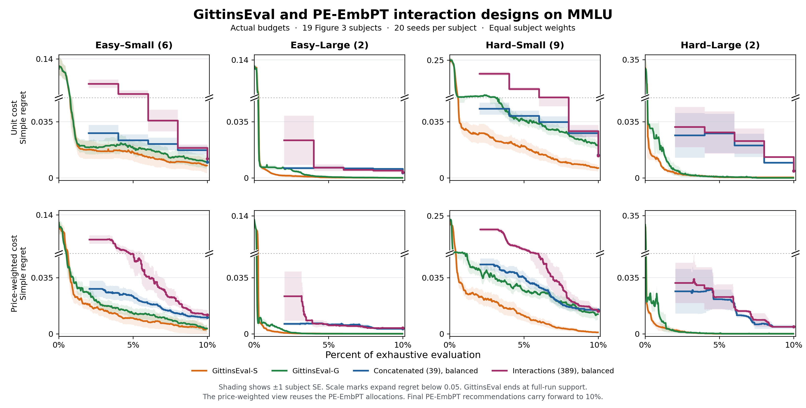

# MMLU PE-EmbPT: model-specific prompt effects

Model-specific prompt coefficients did not produce a consistent gain under this protocol. Both interaction variants had higher mean regret than their concatenated counterparts at 2%–8% of evaluation cells. At 10%, the random-question means were almost equal; balanced interaction had **12.4% higher mean regret** than balanced concatenation. GittinsEval-S retained lower cohort mean regret than both interaction variants at all **36 fully supported Figure 3 checkpoints**.

This experiment compares two adaptations of pretrained-embedding PromptEval to joint LLM–prompt selection. The first shares prompt coefficients across LLMs; the second gives each LLM its own coefficients. Both retain model offsets and question effects. The experiment covers all 57 MMLU subjects, 20 sampling seeds, and both random-question and balanced-question sampling. The GittinsEval comparison uses the 19 subjects supplied with Figure 3.

[Main comparison (PNG)](../PE_EmbPT_interaction_data_2026-11-07/figure/Figure3_PE_EmbPT_interaction.png) · [PDF](../PE_EmbPT_interaction_data_2026-11-07/figure/Figure3_PE_EmbPT_interaction.pdf) · [Sampling comparison (PNG)](../PE_EmbPT_interaction_data_2026-11-07/figure/Figure3_PE_EmbPT_interaction_sampling.png) · [PDF](../PE_EmbPT_interaction_data_2026-11-07/figure/Figure3_PE_EmbPT_interaction_sampling.pdf)



## What the second method changes

We fit each subject independently. Each subject has a response matrix with 1,500 candidate rows: 15 LLMs crossed with 100 prompt templates. Its columns are the subject's $N$ questions. Let $m$ denote the LLM, $p$ the prompt template, $q$ the question, $e(p)\in\mathbb R^{25}$ the cached prompt features, and $d(m)\in\mathbb R^{14}$ the model indicators. Model 0 (`meta_llama_llama_3_8b`) has an all-zero indicator and a fixed-zero offset.

The first version concatenates prompt coordinates and model indicators:

$$
x^{(1)}_{m,p}=[e(p);d(m)]\in\mathbb R^{39},\qquad
\ell^{(1)}_{m,p,q}=\gamma^\top e(p)+\alpha_m+\eta_q,\quad \alpha_0=0.
$$

Its 25 prompt coefficients $\gamma$ are shared across all 15 LLMs. The second version uses the interaction design:

$$
x^{(2)}_{m,p}=[\operatorname{onehot}_{15}(m)\otimes e(p);d(m)]\in\mathbb R^{389},\qquad
\ell^{(2)}_{m,p,q}=\gamma_m^\top e(p)+\alpha_m+\eta_q,\quad \alpha_0=0.
$$

There are 15 blocks of 25 prompt coefficients, plus 14 model offsets: $15\times25+14=389$. **Blocks belong to LLMs.** All 100 prompts for the first LLM use the first block, populated with their respective embedding values; all 100 prompts for the second LLM use the next block. The remaining prompt blocks in each row are zero. The implementation preserves the original prompt coordinates without rescaling.

This permits an LLM to respond differently to a prompt feature while still sharing evidence across prompts within that LLM. Question identity features supply one coefficient $\eta_q$ shared by all candidate rows, so the LLMs remain connected through question effects. A positive $\eta_q$ denotes easiness; a difficulty coefficient would have the opposite sign. There is no additional intercept. The fits contain $39+N$ and $389+N$ coefficients, respectively. Neither design learns an LLM embedding or a model-similarity matrix. [Feature construction and estimator adapter](../experiments/mmlu_pe_embpt/interaction.py)

We refer to these as **concatenated PE-EmbPT** and **interaction PE-EmbPT**, both adapted to joint model–prompt selection. The interaction construction is our adaptation; it should not be presented as an unmodified implementation proposed in the original PromptEval paper.

## Fitting, sampling, and cost accounting

For each phase, both versions fit native `ExtendedRaschModel` logistic regression to all observed responses, including responses from eliminated arms. The estimator uses L2-regularized LIBLINEAR with `C=100`, `random_state=0`, and `fit_intercept=False`. The second version uses a sparse observed-cell design equivalent to the native dense design. Pretrained prompt features remain fixed throughout the experiment.

Each arm's score is the mean of its observed outcomes and the predicted probabilities for its unanswered questions:

$$
\widehat S_{m,p}=\frac{1}{N}\left(\sum_{q\in O_{m,p}}Y_{m,p,q}+\sum_{q\notin O_{m,p}}\sigma(\operatorname{clip}(\widehat\ell_{m,p,q},-30,30))\right).
$$

The replay uses successive halving with five phases at cumulative budgets of 2%, 4%, 6%, 8%, and 10% of the matrix cells. The active set sizes before elimination are 1,500, 750, 375, 187, and 93. The phase recommendation is the highest-scoring active arm. Each new observation chooses among the least-observed active arms, breaking ties randomly.

| Variant | Arm coefficients | Question choice for the selected arm |
| --- | ---: | --- |
| Concatenated, random (`rasch39_random`) | 39 | Uniform among its unanswered questions |
| Concatenated, balanced (`rasch39_balanced`) | 39 | Uniform among its least-covered unanswered questions |
| Interaction, random (`rasch389_random`) | 389 | Uniform among its unanswered questions |
| Interaction, balanced (`rasch389_balanced`) | 389 | Uniform among its least-covered unanswered questions |

Balanced sampling counts question coverage across all arms, including eliminated arms. Each matched-sampler comparison uses the same seeds and initial samples. Later allocations can differ because the fitted scores change which arms survive. All runs retain the first version's random-number ordering and phase seed handling.

Original PromptEval selected prompts separately within each LLM. Pooling 1,500 LLM–prompt pairs changes that task. We also retain the first adaptation's five-phase cap; the uncapped upstream formula would give 11 phases on this pooled task. The reported phase recommendation uses the full-row estimate above, whereas the upstream terminal rule used empirical means among surviving prompts. [Protocol](../PE_EmbPT_interaction_data_2026-11-07/protocol.json) · [First-version report](mmlu_pe_embpt_experiments.md)

The unit-cost axis is observed cells divided by all cells. The price-weighted axis applies the same fixed model input-token price weights to those observations and divides by exhaustive weighted cost. **Prices do not guide PE sampling.** The price view reuses the same observation-budgeted histories. At a requested budget, a PE curve reports the latest completed phase, carrying the final recommendation forward to 10% when it is already available.

### Regularization and embedding provenance

We hold `C=100` fixed to compare the two complete parameterizations under the existing estimator. This does not match the regularization of every shared predictive function: copying one shared prompt coefficient vector into all 15 interaction blocks multiplies its prompt-term squared L2 penalty by 15. Consequently, this comparison includes both the additional flexibility and the changed effect of regularization. It does not isolate a pure causal effect of removing cross-model prompt sharing. No hyperparameters were selected using these results.

Both versions use the same saved upstream features: 25 PCA coordinates from `sentence-transformers/facebook-dpr-question_encoder-multiset-base`, computed from unfilled prompt templates within each subject. The upstream encoder revision was not pinned, and the exact encoder snapshot is unavailable in the archived inputs. The saved arrays and their hashes define the replay inputs. We neither fine-tune nor re-encode the prompts; this is not PE-EmbFT. [Feature provenance](../PE_EmbPT_interaction_data_2026-11-07/provenance/feature_provenance.json)

## Results across all 57 subjects

| Unit budget | Logistic BAI (39) | Concatenated, random | Interaction, random | Concatenated, balanced | Interaction, balanced |
| ---: | ---: | ---: | ---: | ---: | ---: |
| 2% | 0.02624004 | 0.02445305 | 0.08437546 | 0.02516509 | 0.08420448 |
| 4% | 0.02458780 | 0.02290746 | 0.04499031 | 0.02289494 | 0.04623259 |
| 6% | 0.02393083 | 0.02039984 | 0.02702898 | 0.02056374 | 0.02805705 |
| 8% | 0.02322175 | 0.01586805 | 0.01795537 | 0.01649863 | 0.01837180 |
| 10% | 0.02171928 | 0.00951678 | 0.00948385 | 0.00905031 | 0.01017414 |

At 10% unit cost, the interaction-minus-concatenation difference with random questions was **−0.00003293**, with subject standard error **0.00046207**. Interaction had lower subject mean regret in 26 subjects, tied in 2, and higher regret in 29. The small overall mean difference provides no clear average advantage for this design at the endpoint.

With balanced questions, the interaction-minus-concatenation difference was **+0.00112382**, with subject standard error **0.00040516**: lower in 19 subjects, tied in 1, and higher in 37. Ties use an absolute tolerance of $10^{-12}$. Balanced interaction also had higher mean regret than random interaction at this endpoint, by 0.00069029 with subject standard error 0.00040300. Both interaction variants nevertheless improved on the arm-only logistic comparator in all 57 subjects at 10% unit cost.

The price-weighted 10% means were 0.00978393 and 0.00990546 for concatenated and interaction random sampling, and 0.00943791 and 0.01044232 for concatenated and interaction balanced sampling. The respective paired differences were +0.00012154 (subject SE 0.00046126) and +0.00100441 (subject SE 0.00042902). The logistic comparator's mean was 0.02177324.

Simple regret is the best full-matrix arm mean minus the recommended arm's full-matrix mean. We average 20 seeds within each subject and then weight the 57 subjects equally. Paired contrasts match seeds within a subject; their reported standard errors are across subject mean differences.

[All-subject checkpoints](../PE_EmbPT_interaction_data_2026-11-07/data/all57_bai_checkpoints.csv) · [Per-subject checkpoints](../PE_EmbPT_interaction_data_2026-11-07/data/all57_bai_subject_checkpoints.csv) · [New seed-level phase records](../PE_EmbPT_interaction_data_2026-11-07/supplementary/interaction_seed_traces.csv)

The historical logistic comparator retains 39 arm features and a constant, fits no question effects, and ranks fitted arm scores. Comparing it with either PE adaptation changes both the estimator's question effects and its recommendation score. Comparing the two PE designs does not establish whether the pretrained prompt coordinates improve on model indicators alone.

## Comparison with GittinsEval

| PE adaptation | Lower than GittinsEval-S | Lower than GittinsEval-G |
| --- | ---: | ---: |
| Concatenated, random | 0 of 36 | 4 of 36 |
| Concatenated, balanced | 0 of 36 | 4 of 36 |
| Interaction, random | 0 of 36 | 1 of 36 |
| Interaction, balanced | 0 of 36 | 0 of 36 |

GittinsEval-S had lower mean regret than both interaction variants at all 36 reported cohort checkpoints. GittinsEval-G had lower mean regret in 35 of 36 comparisons with random interaction and all 36 with balanced interaction. The random-interaction exception was Hard–Small at 8% price-weighted spend. These are descriptive comparisons of checkpoint means, not 36 independent statistical tests.

Interaction had lower regret than the same-sampler concatenated version at 9 of 36 checkpoints for random questions and 8 of 36 for balanced questions. Thus the extra model-specific prompt coefficients did not improve the Figure 3 comparison consistently either.

The Figure 3 cohorts contain 6 Easy–Small, 2 Easy–Large, 9 Hard–Small, and 2 Hard–Large subjects. GittinsEval-S and GittinsEval-G use the supplied dataset-prior and general-prior LCB curve caches, respectively. We reuse these results, with 20 runs per subject, method, and cost mode. The main figure compares both balanced PE designs with both Gittins variants; the sampling figure also shows both random-question PE variants.

All curves use actual spend divided by exhaustive cost. The original Figure 3 display normalized Gittins runs by their observed endpoints; this comparison does not use that endpoint normalization. We interpolate Gittins subject means only within contiguous cache support where all 20 runs contribute. Cohort curves stop at the earliest full-support subject endpoint, approximately 9.97%–10%, and do not extrapolate.

The reported comparison checkpoints are 2%, 4%, 6%, 8%, and 9.9%. There are 36 fully supported cohort checkpoints across the two cost modes: all 20 unit-cost cells and 16 price-weighted cells. The four price-weighted 2% cells lack full PE coverage and are blank. At unit cost, 9.9% still uses the 8% PE recommendation; the all-subject table separately includes the final 10% phase.

Shading denotes one standard error across equally weighted subject means. The available Gittins caches support subject-level comparisons; their full seed-level histories are unavailable. Checkpoint comparisons should not be interpreted as dominance at every intermediate budget or as evidence on the other 38 MMLU subjects.

[Cohort checkpoints](../PE_EmbPT_interaction_data_2026-11-07/data/checkpoints.csv) · [Selected subjects](../PE_EmbPT_interaction_data_2026-11-07/data/selected_tasks.csv) · [Plotted curves](../PE_EmbPT_interaction_data_2026-11-07/data/plotted_curves.csv)

## Reproduction and validation

The full sweep finished successfully: **57 subjects, 2,280 new trajectories, 11,400 phase records, and zero convergence warnings**. The archive audit checked every saved phase against the source matrices and verified source, input, and feature hashes. All 2,280 first-phase observation and price totals matched the corresponding first-version sampler.

On the validation pilot, the sparse adapter and native dense estimator produced bit-identical coefficients, scores, observation masks, and selections across all five phases with both samplers. Flipping unseen labels for the checked observed mask did not change the fit or recommendation.

The independent portable validator recomputed all 760 subject checkpoint rows, 50 aggregate rows, and 19,212 plotted points from the bundled records, covering five BAI variants and 76 Gittins subject curves. Both actual figures were visually inspected, and the standalone replot reproduced both PNGs byte for byte in the pinned environment. The original results bundle passed its unchanged-file hash check.

The [experiment code and run instructions](../experiments/mmlu_pe_embpt/README.md) reproduce the local replay from the repository's saved response matrices and prompt features. They require no model API calls. The new results bundle preserves the first version's reference data unchanged alongside the new phase records and both comparisons.

To validate the portable bundle and regenerate its figures:

```sh
python -m pip install -r PE_EmbPT_interaction_data_2026-11-07/requirements.txt
python PE_EmbPT_interaction_data_2026-11-07/validate_bundle.py
python PE_EmbPT_interaction_data_2026-11-07/replot.py
```

The bundle contains phase-level outcomes and spending, source and input hashes, standalone plotting code, and independent validation records. It does not contain every observed cell mask or fitted coefficient vector from every phase. A complete experiment replay uses the original saved matrices and features in this repository.

[Bundle instructions](../PE_EmbPT_interaction_data_2026-11-07/README_文件说明.txt) · [Validation records](../PE_EmbPT_interaction_data_2026-11-07/validation.json)
